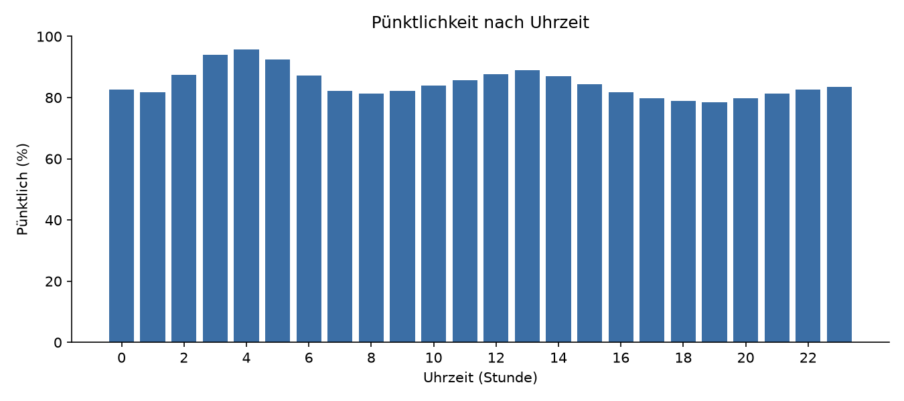
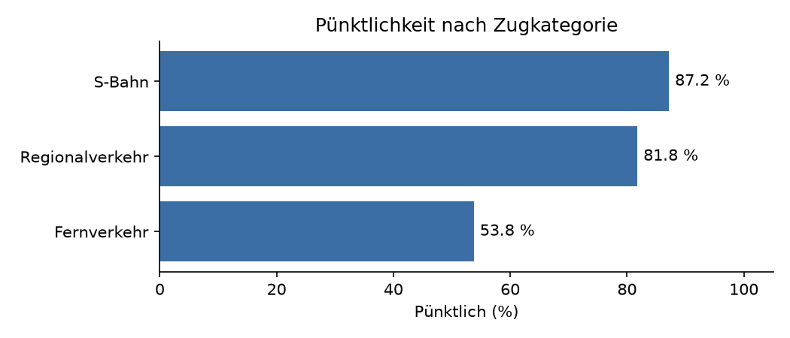

# Wie pünktlich ist die Bahn wirklich?

Auswertung der Pünktlichkeit von Zügen der Deutschen Bahn auf Basis offener Daten:
mehrere Millionen Halte pro Monat, ausgewertet mit **Python, DuckDB (SQL) und pandas**.

Fragen, die das Projekt beantwortet:
- Wie hoch ist die Pünktlichkeitsquote, getrennt nach Fern-, Regional- und S-Bahn-Verkehr?
- Zu welcher Uhrzeit sind Züge am unpünktlichsten?
- Welche großen Bahnhöfe haben die meisten Verspätungen?
- Wie viele Halte fallen aus?

## Ergebnisse

Datengrundlage: Oktober 2026, 15,2 Millionen Halte an allen Bahnhöfen.

| | Pünktlich | Ø Verspätung | Ausfälle |
|---|---|---|---|
| **Gesamt** | 83,7 % | | 3,5 % |
| Fernverkehr | 53,8 % | 12,6 Min | 4,5 % |
| Regionalverkehr | 81,8 % | 3,6 Min | 3,1 % |
| S-Bahn | 87,2 % | 2,5 Min | 4,0 % |

- **Der Fernverkehr ist das Problem.** Nur gut jeder zweite Halt eines ICE/IC ist pünktlich.
  Naheliegende Erklärung: Auf langen Strecken sammelt sich Verspätung an und wird von Halt zu Halt weitergetragen.
- **Berufsverkehr kostet Pünktlichkeit.** Nachts (3–5 Uhr) sind über 90 % der Halte pünktlich,
  morgens um 8 Uhr und abends zwischen 17 und 19 Uhr nur rund 80 %.
- **Unter der Woche wird es zum Freitag hin schlechter** (Montag 84,0 %, Freitag 80,8 %).
  Am Wochenende ist es deutlich besser (Sonntag 89,2 %).
- **Die unpünktlichsten großen Bahnhöfe liegen fast alle in Nordrhein-Westfalen**: Hamm (57,4 %),
  Hagen, Wuppertal, Gelsenkirchen, Köln und Düsseldorf. Vermutlich überträgt das dichte Netz
  im Ruhrgebiet und am Rhein Störungen schnell auf viele Linien. Vollständige Liste: `docs/bahnhof_rangliste.csv`.




## Methode

- **Pünktlich** heißt wie bei der DB: weniger als 6 Minuten Verspätung.
- **Ausgefallene Halte** zählen nicht in die Pünktlichkeitsquote, sondern getrennt in die Ausfallquote.
  Dadurch kann die Quote besser aussehen, als sich die Bahn für Fahrgäste anfühlt.
- Bei der Bahnhofs-Rangliste werden nur Bahnhöfe mit mindestens 10.000 Halten im Monat berücksichtigt,
  damit kleine Stationen mit wenigen Zügen das Ergebnis nicht verzerren.
- DuckDB liest die Parquet-Dateien direkt und filtert per SQL, bevor die Daten in pandas geladen werden.

## Aufbau

```
scripts/download.py        Monatsdateien herunterladen
scripts/report.py          Kennzahlen ausgeben und Diagramme erzeugen
src/bahnanalyse/laden.py   Daten mit DuckDB laden und aufbereiten
src/bahnanalyse/kennzahlen.py  Berechnung der Kennzahlen
tests/                     Tests mit kleinen, selbst gebauten Beispieldaten
```

## Ausführen

```bash
python -m venv .venv
.venv\Scripts\activate          # Windows (macOS/Linux: source .venv/bin/activate)
pip install -e ".[dev]"

python scripts/download.py 2026-08 2026-09 2026-10
python scripts/report.py
python scripts/report.py --bahnhof Berlin
pytest
```

## Daten

[piebro/deutsche-bahn-data](https://huggingface.co/datasets/piebro/deutsche-bahn-data),
gesammelt aus den öffentlichen APIs der Deutschen Bahn, Lizenz CC BY 4.0.
Die Rohdaten sind nicht Teil dieses Repos (`data/` steht in `.gitignore`).

## Hinweis

Entstanden mit Unterstützung von KI (Claude) als Lernprojekt.
